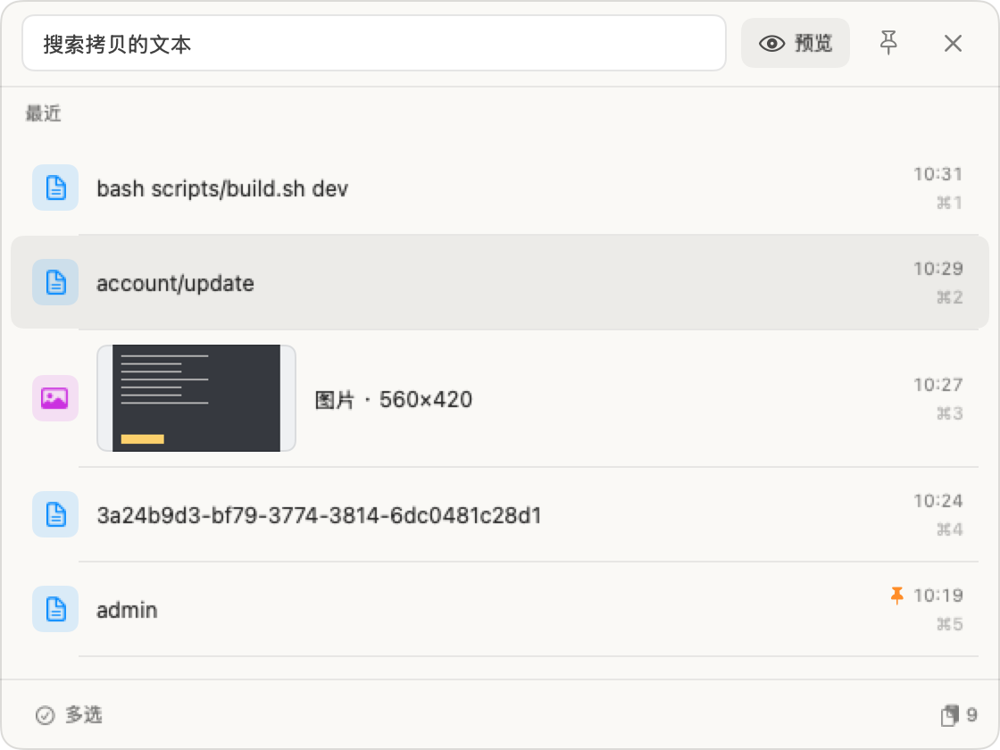
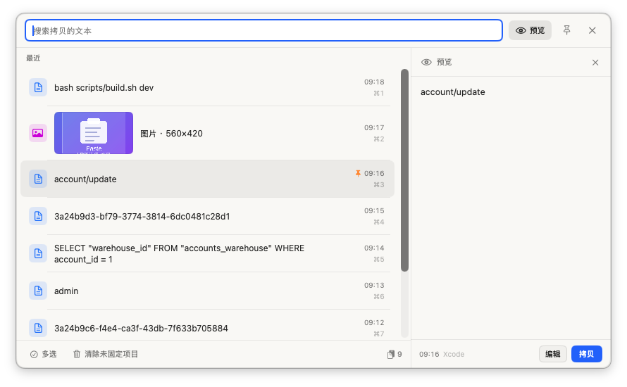
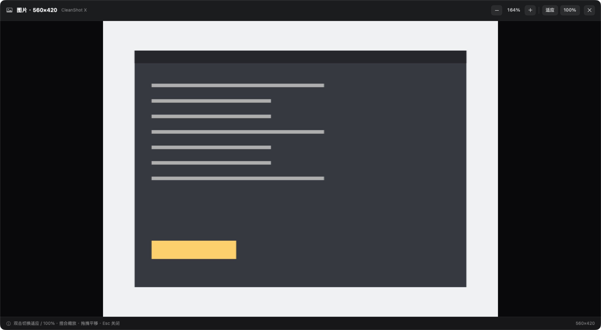

# Paste

一个用 SwiftUI + AppKit 编写的 macOS 剪贴板历史工具。界面为紧凑的浮动面板：顶部搜索、中间历史列表、右侧可展开预览、底部多选与计数。







## 功能

- **监听系统剪贴板**：轮询 `NSPasteboard.general`，保存文本、图片、文件复制记录；忽略密码管理器等标记为临时/机密的剪贴板类型。
- **历史持久化**：记录保存在 `~/Library/Application Support/Paste/`，图片以 PNG 存于 `Images/`，重启后仍然存在。
- **按时间倒序**：最新复制的内容在最上面；重复复制同一内容不会新增一条，而是刷新时间并移到最上面，同时保留固定状态。
- **搜索**：对文本、文件名、路径、来源应用和图片尺寸做不区分大小写的实时过滤。焦点默认始终在搜索框，直接打字即可。
- **预览**：点击顶部「预览」或按空格/⇧空格展开右侧预览区；文本可查看/编辑，**拖动选择文本后可用 `⌘C` 复制**，图片显示缩略预览，文件列出路径。鼠标悬浮条目时预览跟随鼠标，方向键选择时预览跟随键盘。
- **类型筛选**：列表顶部可按「全部 / 文本 / 图片 / 文件」筛选，搜索会叠加在当前筛选内；搜索框为空时可用 `←` / `→` 快速切换筛选项。
- **快贴**：顶部 Tab 在「剪贴板 / 快贴」间切换（按 `Tab` 键也可）；快贴支持搜索、文件夹（全部/未分类/自定义）、新建/编辑/删除、备注和同一套右侧预览。左侧为文件夹与快贴列表，底部显示快贴条数。
- **图片大图**：点击预览区中的图片，或点击底部「查看大图」，打开独立图片查看窗口；默认适应窗口，支持适应/100%、触控板捏合缩放、放大后拖拽平移，`Esc` / `⌘W` 关闭。
- **自动粘贴**：双击条目、回车、右键「粘贴」或 `⌘1`–`⌘9` 会复制并尽量向原应用发送 `⌘V`。未授予辅助功能权限时退化为仅复制，并给出提示。
- **窗口置顶**：顶部图钉按钮控制窗口始终在其他应用之上。固定后，`Esc`、回车、双击粘贴都不会隐藏窗口。
- **多选删除**：底部「多选」进入勾选模式，出现「删除 N」按钮；也可用 `⌫` 删除已勾选条目。
- **固定项目**：右键条目可固定/取消固定。固定项目不受历史上限清理。
- **菜单栏驻留**：关闭窗口不会退出应用；菜单栏图标和全局快捷键 `⌥V` 可再次唤出。
- **深浅色适配**：跟随系统外观。

## 快捷键

| 按键 | 行为 |
| --- | --- |
| `⌥V` | 全局打开/隐藏 Paste（菜单栏图标也可） |
| `↑` / `↓` | 剪贴板：切换选中条目；快贴：在列表区切换快贴，进入文件夹区后切换文件夹 |
| `←` / `→` | 搜索框为空时：剪贴板切换筛选项；快贴按 `←` 进入文件夹区、按 `→` 回到列表区；有搜索内容时用于移动光标 |
| `空格` | 搜索框为空时打开/关闭预览；有搜索内容时输入空格 |
| `⇧空格` | 随时打开/关闭预览（搜索框有内容时也能用） |
| `回车` | 复制并粘贴当前条目 |
| `⌘1` … `⌘9` | 复制并粘贴当前筛选结果中的第 1–9 条 |
| `Tab` / `⇧Tab` | 在「剪贴板」和「快贴」之间切换 |
| `⌘F` | 聚焦搜索框 |
| `⌘W` / `Esc` | 关闭面板；`Esc` 会优先退出编辑/多选/清空搜索，不会关闭预览区 |
| 双击条目 | 复制并粘贴 |
| 点击预览图片 / 点击「查看大图」 | 打开大图窗口 |
| 大图窗口：双击 / `适应` / `100%` | 切换适应窗口与实际大小 |
| 大图窗口：`Esc` / `⌘W` | 关闭大图窗口 |
| 右键条目 | 拷贝、粘贴、固定、删除 |
| `⌘Q` | 退出应用 |

> 由于搜索框始终接收输入，普通空格在搜索框为空时切换预览，已有搜索词时正常输入空格。任何时候都可以按 `⇧空格` 或点击顶部「预览」切换预览。

## 构建与运行

要求 macOS 14+、Xcode 15+（本项目在 macOS 26 / Swift 6.3 上构建）。

```bash
# 构建并生成 dist/Paste.app
./Scripts/build.sh

# 打开应用
open dist/Paste.app
```

也可以：

```bash
# 直接构建并打开
./Scripts/run.sh

# 构建并在前台运行（便于看日志）
./Scripts/run.sh --foreground
```

`Scripts/build.sh` 会自动寻找本机的 `Paste Local Signing` 或 `Clipboard Local Signing` 稳定代码签名身份；找不到时使用 ad-hoc 签名并给出警告。稳定身份能让「辅助功能」授权在重新构建后继续有效。

## 辅助功能权限

自动粘贴通过 `CGEvent` 向目标应用发送 `⌘V`，需要：

**系统设置 → 隐私与安全性 → 辅助功能 → 勾选 Paste**

未授权时，Paste 仍会把内容复制到剪贴板，并显示可跳转到系统设置的提示，手动按 `⌘V` 即可。首次请求粘贴时 macOS 也会弹出授权提示。

## 数据与隐私

- 历史路径：`~/Library/Application Support/Paste/history.json`
- 图片路径：`~/Library/Application Support/Paste/Images/<uuid>.png`
- 最多保留 200 条（固定项目不计入滚动上限）；超出时自动清理最旧的未固定记录。
- 数据完全保存在本机。密码管理器写入的 Transient/Concealed 类型剪贴板不会被记录。
- 删除条目时会一并删除对应图片文件。

## 项目结构

```
Sources/
  Paste/                 # 可执行入口（NSApplication）
  PasteKit/
    App/                 # AppDelegate、浮动面板、菜单栏、全局快捷键、键盘路由
    Models/              # ClipboardItem / ClipboardPayload / Toast
    Services/            # 剪贴板读取与监听、持久化、写回、自动粘贴、全局热键
    Views/               # SwiftUI：顶部栏、历史列表、预览、底部栏、Toast
    AppModel.swift       # UI 状态与所有交互入口
Tests/PasteKitTests/     # 22 个历史和搜索单元测试
Scripts/                 # 构建、运行、图标生成
Resources/               # Info.plist、AppIcon.icns
docs/                    # UI 契约和截图
```

## 测试

```bash
swift test
```

覆盖：时间倒序、重复内容合并并置顶、固定状态保留、批量删除、历史上限裁剪、图片文件落盘与读取、旧版 JSON 容错、文本编辑和搜索匹配。

## 实现说明

- 面板是一个无标题栏的 `NSPanel`，顶部 Tab 占 36pt；折叠尺寸 560×456，预览展开后 844×540；以窗口中心为锚点做 0.5 秒过渡，预览列固定 284pt 并从右侧逐步露出，列表不会被压缩或推挤。
- 快贴数据保存在同一数据目录下的 `quick.json`，与剪贴板历史互不影响。
- 历史列表使用 `LazyVStack` 虚拟化；列表缩略图限制在 256px，预览图限制在 640px，原图只在大图查看时加载，隐藏面板时会清空图片缓存。
- UI 使用 SwiftUI，AppKit 负责窗口、菜单栏、全局快捷键和聚焦控制。
- 全局快捷键使用 Carbon `RegisterEventHotKey`，不依赖辅助功能权限。
- 剪贴板监听使用主 RunLoop 的 common mode 定时器，应用自身写回剪贴板时会确认 changeCount，避免把自己的写入重复记录。
